# Yuepao

个人用的 iOS 私密记录 App：后宫档案、约会记录、地图足迹、成就和统计。数据只存在手机本地，不联网。

主屏幕上显示的名字是「手账」，图标是一本皮面手账。设置里还能换成另外三种颜色：墨黑、象牙、夜蓝。

## 截图

下面是用演示数据在模拟器里自动截的图，每次手动运行 CI 时可以选择更新。

| 后宫 | 档案详情 | 日程 |
| --- | --- | --- |
| 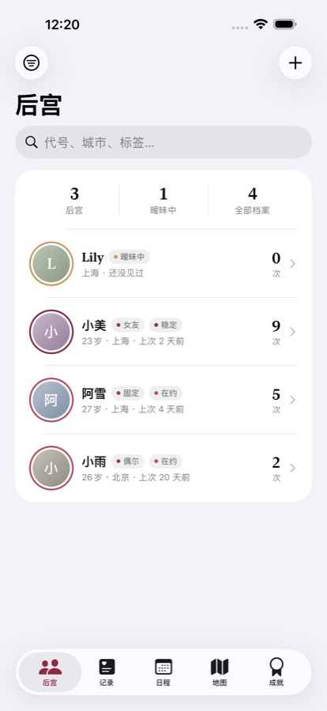 | 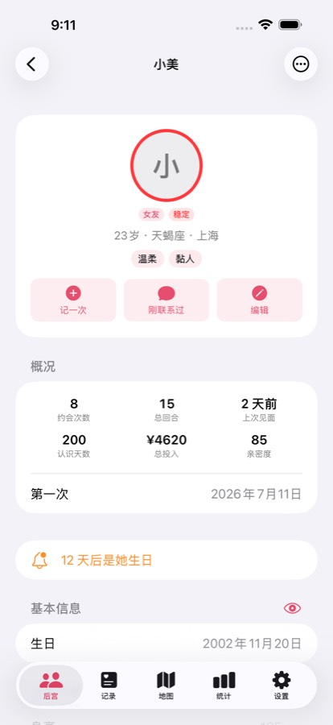 | 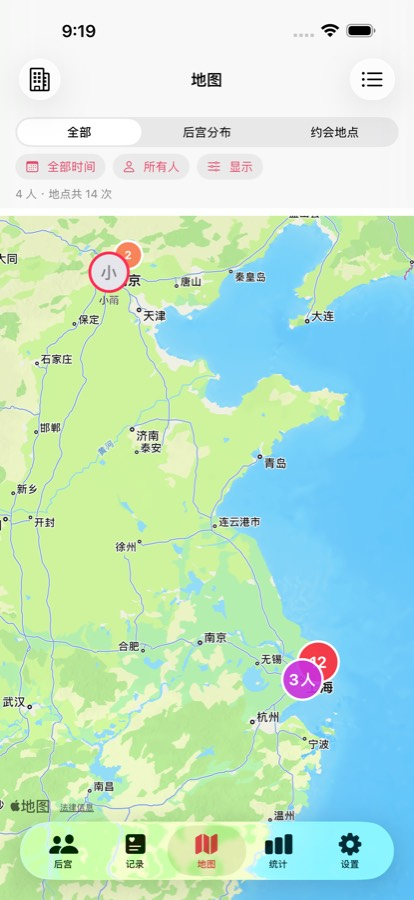 |
| **周期** | **地图** | **成就** |
| 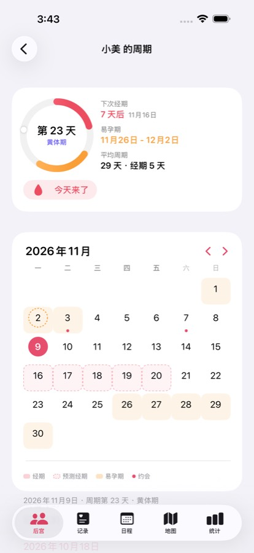 | 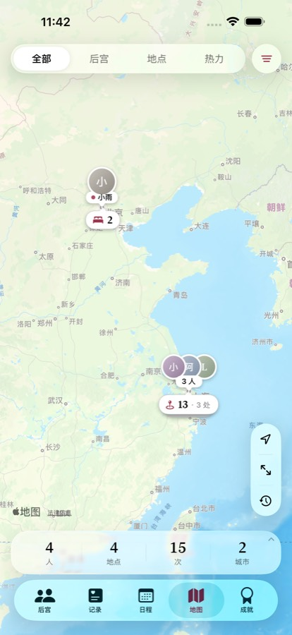 | 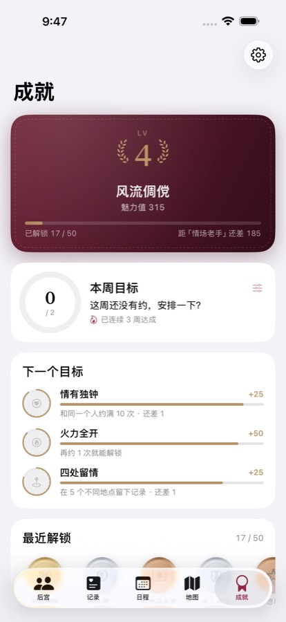 |
| **地图：选中一个人** | **地图：热力** | **地图：足迹回放** |
| 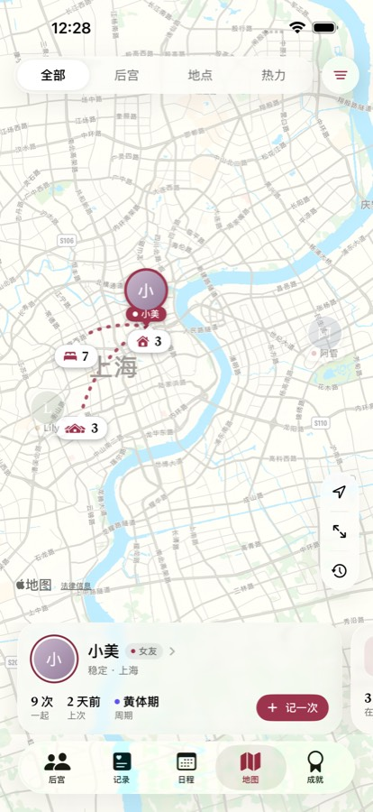 | 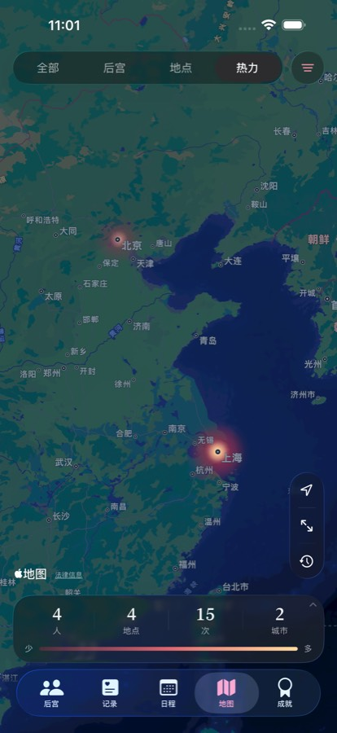 | 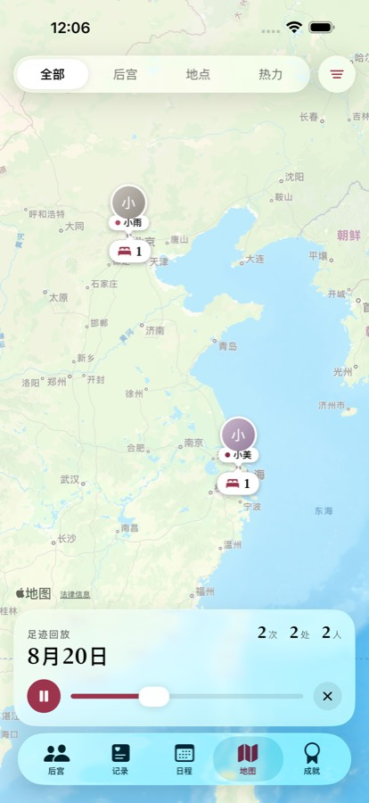 |
| **记一次** | **记一次：道具** | **记录详情** |
| 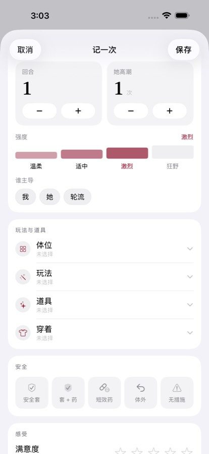 | 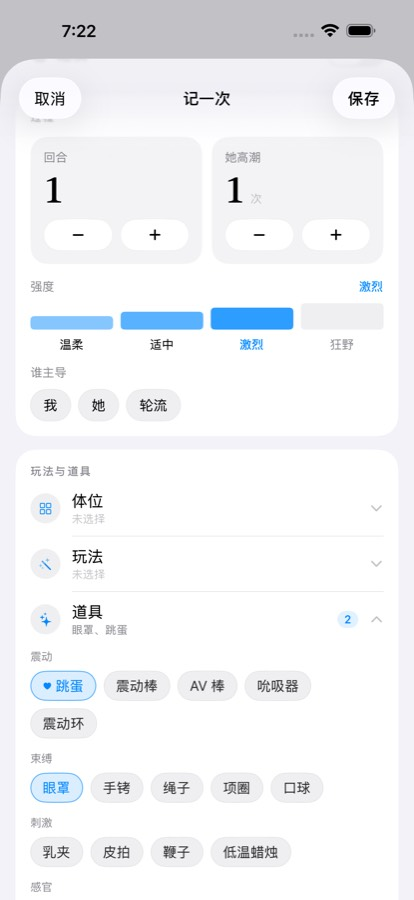 | 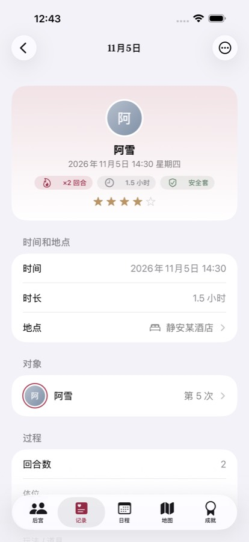 |
| **建档** | **档案：后宫属性** | **亲密档案** |
| 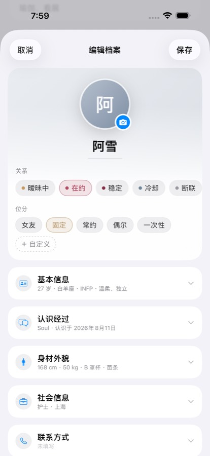 | 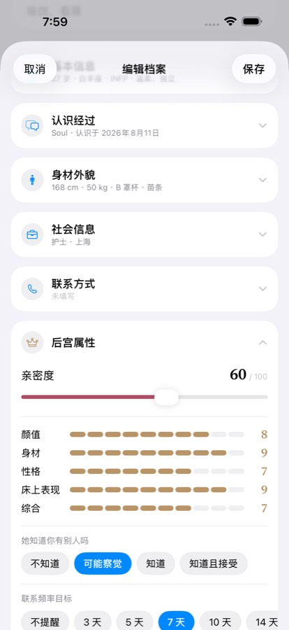 | 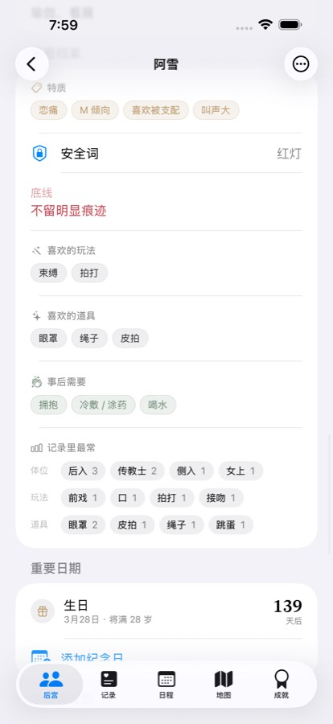 |
| **记录里的照片** | **全屏看视频** | **相册** |
| 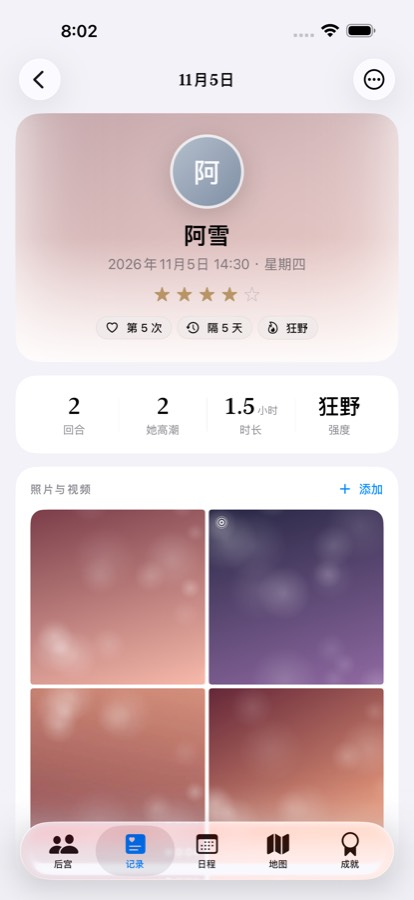 | 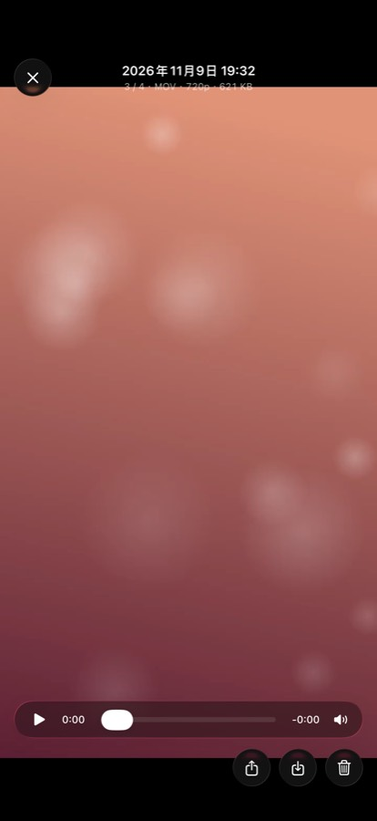 | 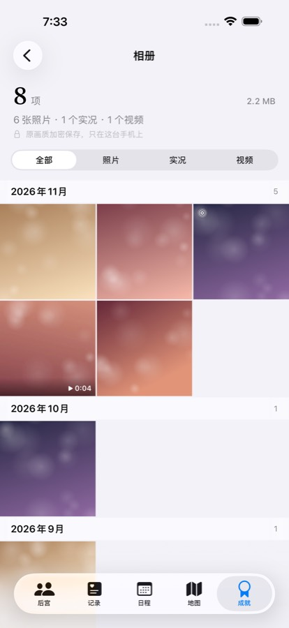 |

## 拿到 IPA

每次往仓库推代码，GitHub Actions 都会自动编译一个**未签名**的 IPA：

1. 打开仓库的 **Actions** 页面，点进最新一次成功的 **Build IPA**。
2. 在页面底部的 **Artifacts** 里下载 `Yuepao-<编号>-ipa`。
3. 下载到的是 zip，解压后得到 `Yuepao.ipa`，用你自己的方式签名安装即可。

打一个 `v` 开头的 tag（比如 `v0.1.0`）时，IPA 还会额外发布到 **Releases** 页面，在手机上可以直接下载。

也可以在 Actions 页面点 **Run workflow** 手动触发编译。

每次编译还会在 iOS 模拟器里跑一遍自动化测试（启动、建档、记一次、逛遍所有页面），确保 App 能正常打开、不闪退。

## 不丢数据

- **Bundle ID 不要改**（`com.lluviose.yuepao`）。续签后直接覆盖安装，数据会保留。
- **删除 App 会丢失全部数据。** 请定期在「设置 → 导出加密备份」里导出备份，保存到「文件」或电脑上。
- 备份文件用你设置的密码加密（AES-256）。忘记密码就无法恢复。
- 备份里的照片、视频、实况都是原文件。视频多的话备份会很大，导出时可以选择不带视频。旧版本导出的备份也能恢复。

## 功能

- **后宫档案**
  - 建档页：头像、代号、关系和位分在最上面一次填完，代号输入时背景色调跟着变；其余资料按类别折叠成卡片，收起时显示已填的摘要
  - 身高体重三围是大号数字格，罩杯、体型、学历、渠道等直接点选，评分是十格点选（再点一次清零），MBTI 点四个维度的字母拼出类型；代号和已有档案重名时会提醒
  - 档案页的约会记录只列最近 5 条，「查看全部」按月分组
  - 基本信息、身材外貌、社会信息、联系方式、认识经过
  - 后宫属性：位分、关系状态、亲密度、评分、知情度、社交圈交集、联系频率目标
  - 偏好与雷区、「她说过的事」（引用样式）、生理期预测、重要日期（倒数几天、将满几岁、第几周年）、礼物和红包（快捷金额 52、131.4、520、1314…），以及时间线备忘、相册和自定义字段
  - 亲密档案：特质 / 性癖（恋痛、M / S 倾向、敏感体质等，分组可选）、安全词、底线、喜欢的体位、玩法和道具、事后需要；还会从记录里统计她最常用的体位、玩法和道具
- **约会记录**
  - 一页卡片式表单，常用的直接点选：对象（支持多人）、地点、时间和时长、过夜
  - 过程：回合数和她高潮次数（大号数字加减）、强度（温柔 / 适中 / 激烈 / 狂野）、谁主导；强度选到激烈以上时，会把她约好的安全词显示在旁边
  - 玩法与道具：体位、玩法、道具（震动、束缚、刺激、感官等分组）、穿着。每项折叠成一行，点开在原地多选，也能现场加自定义选项
  - 记录时可以顺手勾选她的特质，保存后同步到她的档案
  - 安全措施用五个选择块；有风险时会提醒紧急避孕和后续检测
  - 感受：满意度、化学反应、氛围、她的反馈（包括「有点疼」「叫停过」）、事后照顾
  - 约会内容、谁主动约、花费明细、备注、照片和视频（加了照片时可以一键改成照片的拍摄时间）
  - 记录列表每条下面会带上这次的体位、玩法、道具关键词；详情页按卡片分组展示，还会标出和上一次隔了几天
  - 记录页顶部可以按人筛选（头像上带次数）；长按一条记录可以再记一次、编辑或删除；搜索也能搜体位、道具这些关键词
  - 新记录有快捷开始时间（刚刚 / 1 小时前 / 昨晚 10 点）；只选了一个人时显示「和她的第几次」，这次会让羁绊升级时会提前告诉你；她档案里写着喜欢的体位、玩法、道具和事后照顾会带一颗小红心
- **照片和视频**
  - 原画质保存：照片按原文件存（HEIC 就是 HEIC），视频不转码，实况照片连同配对视频一起存。导入时一张张出现，视频标时长，实况标图标。
  - 记录详情里照片放在前面，三张以上第一张是大图；档案里有她的相册，还能看和她有关的全部照片视频。
  - 全屏查看：双指或双击放大，单击隐藏按钮，上下拖动关闭；实况长按或点「实况」播放；视频直接播放原文件，可以拖动进度、静音。
  - 顶部显示拍摄时间、格式、像素和大小。可以存回系统相册（实况还是实况）、分享原文件、设为头像、删除。
  - 「成就 → 相册」按月份浏览全部照片视频，可以只看照片、实况或视频。
  - 文件分块加密，几个 GB 的视频也不会一次读进内存；设置里能看到占用空间，清理没用到的文件。
- **其他记录**：地点（类型一格一个点选、地图选点；详情页有地图、次数、见过几个人、上次去的时间和评分）、性健康检测（常见项目点选、结果、1 / 3 / 6 个月后复查）、关系状态变化（每个阶段持续了多久）
- **地图**
  - 低饱和的素雅底图，四种模式：全部、后宫、地点、热力。底图也可以换成标准或卫星。
  - 人显示成带名牌的头像，名牌上的小圆点表示关系状态或位分。地点显示成「图标 + 次数」的小胶囊。离得太近时，会合并成叠在一起的头像或胶囊。
  - 点一个人，底部弹出她的卡片：一起几次、上次见面、经期或羁绊、离你多远。和她去过的地点用虚线连起来，其余的变淡。左右滑卡片可以按远近切换，地图会跟着移动。
  - 点一个地点，卡片里有次数、上次去的时间、在这里见过谁，可以直接「记一次」或导航过去。
  - 热力模式：按次数画出光斑，越常去越亮。
  - 足迹回放：从第一次开始，按时间顺序把人和地点一个个点亮，可以拖动进度条。
  - 长按地图上任意位置可以新建地点，地址和城市会自动填好。
  - 点底部的统计条打开「足迹」：城市排行（点一下地图飞过去）、最常去的地点、城市印章。
  - 可以按时间和人筛选，生效中的筛选条件显示在顶部，点一下就能清除。
- **日程**
  - 月历上标出约会、待办、纪念日和经期；只看某个人时，还会用底色标出她的经期、预测经期和易孕期。
  - 点某一天可以看当天的安排，也可以直接在那天记一次或加待办。
- **待办**：可以关联档案、设日期和提醒、分类；左滑完成，右滑推迟或删除。
- **生理期**：可以记开始和结束。周期环会显示今天是周期第几天、处在哪个阶段，还会预测下次经期和易孕期。记录约会时，如果那天在她的经期或易孕期，会给出提示。
- **时间线**：把认识、关系变化、约会、备忘、礼物、经期、完成的待办都放进一条时间线，可以筛选。
- **成就**：
  - 一共约 55 枚奖章，分里程碑、后宫、足迹、节奏、探索、体贴六类，按铜、银、金、黑金四档；有些是隐藏成就。体贴类会奖励做好防护、事后照顾、记下她的反馈、约定安全词。
  - 解锁时会有奖章翻转、扫光的动画。奖章攒魅力值，魅力值决定等级（Lv.1–Lv.8）。
  - 「每周目标」显示本周进度和连续达成的周数。
  - 「下一个目标」告诉你离哪个成就最近、还差多少。
- **图鉴**：体位、玩法、道具、穿着、十二星座，试过的会点亮，没试过的是暗的。
- **城市印章**：每到一座新城市，收集一枚邮票样式的印章。
- **心愿清单**：记下想去的地方、想试的玩法、想和她一起做的事；实现心愿也会解锁成就。
- **年度回顾**：全屏卡片翻页，回顾这一年的次数、人、最常去的地方、最热烈的月份、收获的奖章。
- **羁绊等级**：和每个人见得越多，羁绊越高（初识 → 命中注定）。
- **统计**：总览、近 12 个月趋势、最近 20 周热力图、星期和时段分布、排行榜、玩法偏好（最常用的体位、玩法、道具，以及记了事后照顾的次数）、认识渠道、安全情况、花费、冷落名单、近期提醒。在「成就」页底部的「完整统计」进入；设置在「成就」页右上角的齿轮里。
- **隐私**
  - Face ID 解锁；切到后台时遮住内容
  - 照片和视频加密存在 App 内，不进系统相册；播放时解密出的临时文件，关掉查看器就删
  - 敏感字段默认打码；通知可以隐藏内容
- **自定义**：位分、渠道、体位、道具、特质等选项都可以增删和排序（选项管理按档案、亲密、记录、其他分组），还可以加自定义档案字段
- **界面**：暖纸色的底、酒红主色、香槟金点缀，标题和数字用衬线字体；每页最主要的操作是酒红实底的按钮，空页面有引导；浅色、深色都适配

## 开发

工程用 [XcodeGen](https://github.com/yonaskolb/XcodeGen) 描述，没有提交 `.xcodeproj`：

```bash
brew install xcodegen
xcodegen generate
open Yuepao.xcodeproj
```

- 最低支持 iOS 17
- 使用 SwiftUI、SwiftData、MapKit 和 Swift Charts，没有第三方依赖
- 想改主屏幕上的名字，修改 `project.yml` 里的 `CFBundleDisplayName`
